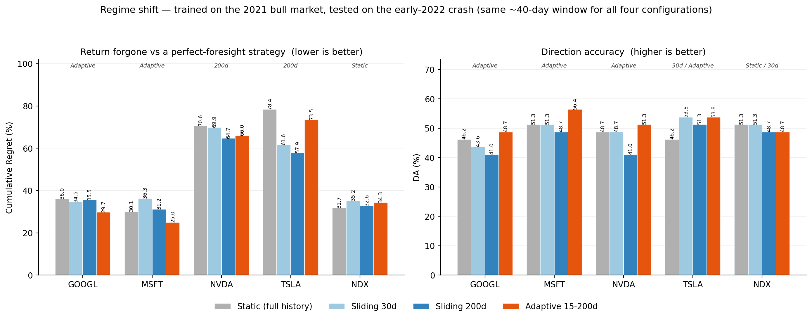
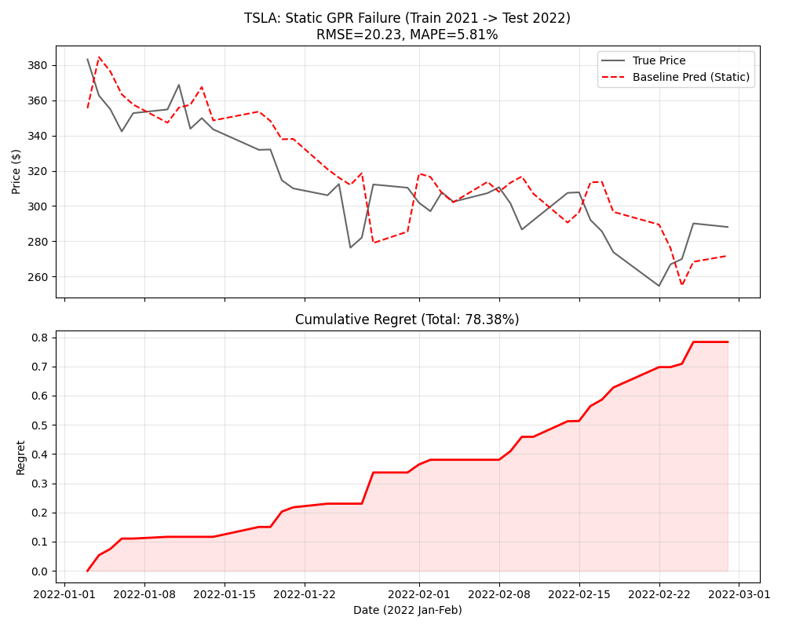

# Adaptive Gaussian Process Regression for Stock Forecasting

[English](README.md) | [中文](README.zh-CN.md)

**Research question · Model comparison · Reproducible experiments**

Gaussian process regression assumes its kernel is stationary over the whole training series.
Stock prices are not. This project measures what that assumption costs when the market changes
character, and whether a volatility-aware adaptive window can recover it.

---

## Results at a glance



Trained through the 2021 bull market, tested on the first ~40 trading days of 2022. All four
configurations run on the same test window, so every bar is directly comparable.

- **The static baseline fails comprehensively.** Under a long/flat strategy it forgoes **78.4%**
  of a perfect-foresight strategy's return on TSLA and **70.6%** on NVDA. Its kernel learned that
  prices trend upward, and it keeps predicting upward through a crash.
- **The adaptive window buys most of that back where it matters.** Lowest forgone return of any
  configuration on GOOGL (29.7% against 36.0%) and MSFT (25.0% against 30.1%), and the lowest
  RMSE on MSFT (6.27 against 8.52) and NDX (304 against 436).
- **It does not win everywhere, and the failure is informative.** On TSLA the adaptive model is
  the worst of the three retraining configurations — 73.5% against 61.6% for the 30-day and 57.9%
  for the 200-day window — and its window spends most of that run pinned at its 15-day floor.
  Discarding stale data is the mechanism, and on a persistently volatile instrument it discards
  too much.
- **Direction accuracy barely separates the four configurations.** Only MSFT shows a gap worth
  reading (56.4% against 51.3%); on two of the five tickers the top DA is a tie.

Section 3 gives the full tables, including RMSE and MAPE; section 4 shows how to reproduce them.

---

## 1. Problem

Gaussian process regression is a Bayesian non-parametric regressor: it places a prior over
functions and conditions on the observed data. The prior is encoded in a kernel, and the
kernel's hyperparameters are **estimated once and then held fixed across the entire series**.

That is a stationarity assumption. It says the covariance between two observations depends only
on how far apart they are in time — not on *when* they occurred. Real price series violate this.
A macro-level calm period and a structural regime shift obey different statistical laws, and a
kernel fitted on one carries the wrong prior into the other.

The failure mode is specific and measurable. Fit the kernel on the 2021 bull market, then
forecast into the early-2022 crash:

- The kernel has learned that prices trend upward, so it predicts upward.
- Under a long/flat strategy — go long if the model predicts a rise, hold cash otherwise —
  the model stays long through the entire drawdown.
- It has **no mechanism to detect that it is wrong**, because nothing in the fixed prior
  represents "the regime has changed."



*TSLA — the worst case. **Top:** the frozen kernel repeats the uptrend it was trained on. In the
first days the dashed prediction rises while the true price falls, and it stays above the price
for most of the window. **Bottom:** forgone return accumulates in steps to 78.38%. Produced by
`code/group1_B.py`.*

**The question this project asks:** how much does that cost, and how much of it can a cheap
change to the training window recover?

## 2. Method

### Data and target

| | |
| :--- | :--- |
| **Source** | NASDAQ public historical quotes ([nasdaq.com](https://www.nasdaq.com/)), downloaded as CSV |
| **Range** | Dec 2015 – Dec 2025, daily bars |
| **Tickers** | GOOGL · MSFT · NVDA · TSLA · NDX (index) |
| **Target** | Next-day close, modelled in log space and exponentiated back |
| **Features** | Engineered in `code/clean_features.py`; scalers fitted on train only |

### The four configurations compared

| Configuration | Window | Retrained? |
| :--- | :--- | :--- |
| **G1 static** | Full history | Once, then frozen |
| **G2 short** | 30 days | Every step |
| **G2 long** | 200 days | Every step |
| **G3 adaptive** | 15–200 days, volatility-driven | Every step |

Four configurations × two market regimes. The regimes are chosen so that one roughly satisfies
stationarity and the other visibly does not, which is what makes the comparison interpretable:
any difference between configurations can be attributed to the regime rather than to the setup.

- **Regime shift** — trained through 2021, tested on the first ~40 trading days of 2022.
- **Calm period** — trained on prior history, tested across 2024.

### The adaptive window

Group 3 picks a window length **per prediction step** from realized volatility, bounded between
15 and 200 days:

```
   window
   length
    200 ┤────────────┐
        │            │              ┌──────
        │  calm:     │  shift:      │  re-stabilizing:
        │  keep all  │  discard     │  grow back
        │  history   │  stale data  │
     15 ┤            └──────────────┘
        └──────────────────────────────────────▶ time
             2021 bull        2022 crash
```

The reasoning: a long window is a low-variance, high-bias estimator. It is the right choice when
the process is stationary, because every extra observation is informative. When the process
changes, those same observations become actively misleading — they describe a regime that no
longer exists. Volatility rising is the observable signature of that transition, so the window
contracts in response and expands again once the new level stabilizes.

A **Rational Quadratic** kernel is used: it is a scale mixture of squared-exponential kernels, so
it has heavier tails and more capacity to represent structure that differs across time scales —
which is what a regime shift looks like.

### Metrics

| Metric | Definition |
| :--- | :--- |
| **RMSE** / **MAPE** | Standard error on price level |
| **DA** | Direction accuracy — sign agreement with the actual next-day move |
| **Regret** | Cumulative return **forgone** versus a perfect-foresight long/flat strategy |

**On Regret, precisely:** at each step the model goes long if it predicts a rise, otherwise holds
cash. The oracle goes long on every day the price actually rose. Regret is the running sum of the
difference in realized returns. It is therefore a *forgone-return* measure, not an error measure,
and because it accumulates it is only comparable across configurations **evaluated on the same
test window**.

## 3. Results

### Regime shift — trained on 2021, tested on the early-2022 crash

~40 trading days. All four configurations on the same window, so all columns are comparable.

| Ticker | G1 static RMSE / Regret | G2 short (30d) | G2 long (200d) | **G3 adaptive** |
| :--- | --: | --: | --: | --: |
| GOOGL | 4.30 / 36.05% | 3.40 / 34.55% | 3.19 / 35.53% | 3.29 / **29.70%** |
| TSLA | 20.23 / 78.38% | 13.35 / 61.60% | 13.23 / **57.86%** | 15.24 / 73.50% |
| NDX | 436.14 / 31.71% | 332.43 / 35.17% | 305.27 / **32.65%** | 304.05 / 34.27% |
| MSFT | 8.52 / 30.05% | 6.75 / 36.27% | 6.29 / 31.18% | **6.27** / **24.96%** |
| NVDA | 1.80 / 70.57% | 1.11 / 69.89% | **1.03** / **64.68%** | 1.06 / 66.01% |

**Where the static baseline fails.** Comprehensively. TSLA forfeits 78.38% and NVDA 70.57% of
the oracle's return over 40 days — under a long/flat strategy the model is simply long through a
crash. This is the predicted failure mode, at a magnitude that needs no argument.

**Where each alternative wins:**

| | Best on |
| :--- | :--- |
| **G3 adaptive** | Lowest Regret on GOOGL (29.70%) and MSFT (24.96%); lowest RMSE on MSFT (6.27) and NDX (304.05); highest DA on GOOGL, MSFT and NVDA |
| **G2 long (200d)** | Lowest RMSE and Regret on TSLA — the single best configuration for that ticker |
| **G2 short (30d)** | Wins nothing outright, but ties the best DA on TSLA and NDX and is the cheapest retraining option |

**Where the adaptive model still loses.** On TSLA it is beaten by the fixed 200-day window on
both metrics (73.50% vs 57.86% Regret). The mechanism works by discarding data, and on an
instrument whose volatility is persistently high it discards too much — it ends up behaving like
a short window at exactly the moment a long window would have been more stable. The same effect
costs it the RMSE lead on NVDA.

**Shorter is not monotonically better.** Cutting 200 days to 30 cuts error substantially, but a
short window adds variance. On the calm-period sequence a short window's Regret exceeds a long
window's — the trade is bias against variance, not a dial marked "less history is more
responsive."

### Control — the calm period (2024)

RMSE. This window is longer than the one above, so the Regret values from that experiment are
**not** comparable here and are omitted.

| Ticker | G1 static | G2 long (200d) | G2 short (30d) |
| :--- | --: | --: | --: |
| GOOGL | 7.69 | **6.69** | 7.52 |
| TSLA | **16.94** | 19.37 | 22.79 |
| NDX | **414.62** | 474.81 | 494.29 |
| MSFT | **8.65** | 10.82 | 11.40 |
| NVDA | **5.30** | 7.05 | 6.96 |

Two readings, and the second is the less comfortable one:

1. **Long beats short on 4 of 5 tickers** — when the regime is stable, more history genuinely
   does fit the trend better, which is the behaviour the adaptive design is built to exploit.
2. **But the static baseline beats both on 4 of 5.** Discarding history to *track* a stable
   regime is a self-inflicted wound. A sliding-window method earns its place only if the regime
   actually moves, and the calm period is precisely the case where it does not.

### Cost

Seconds per ticker, regime-shift window:

| Configuration | Window | Time |
| :--- | :--- | --: |
| G1 static | full history, trained once | **0.27 – 0.30 s** |
| G2 short | 30d, retrained per step | 2.7 – 3.4 s |
| G2 long | 200d, retrained per step | 10.6 – 19.1 s |
| **G3 adaptive** | 15–200d, retrained per step | 2.5 – 6.4 s |

The honest reading is not "the adaptive model is fast." It is: **the adaptive window lands near
the cheap end of the retraining configurations** — 2–6× cheaper than a fixed 200-day window on
the same test window, because it spends most of its time compressed. The genuinely fastest
option by an order of magnitude is not to retrain at all, and that is exactly the configuration
that scores worst on accuracy. The adaptive window is a way to buy back most of the static
baseline's accuracy at a fraction of the long window's cost — not a way to beat the static
baseline's runtime.

### Direction accuracy

The adaptive model takes the highest DA outright on three of five tickers (GOOGL, MSFT, NVDA),
ties the best on TSLA (53.8%, level with the 30-day window), and falls short on NDX (48.7%
against 51.3%). MSFT reaches **56.4%** against the static baseline's 51.3% — the only gap here
worth reading. DA is computed over a ~40-day window, so it moves in steps of 1/39 ≈ 2.6%: MSFT
is a two-step gap, and every other comparison in this section is zero or one step apart, which at
this sample size is not evidence of anything.

## 4. Reproducibility

### Environment

```bash
pip install -r requirements.txt
# numpy>=1.24, pandas>=2.0, matplotlib>=3.7, scikit-learn>=1.3, scipy>=1.10
```

Python 3.9+.

### Data

The six CSV files are included in [`data/`](data/) — 10 years of NASDAQ daily bars
(Dec 2015 – Dec 2025) for GOOGL, MSFT, NVDA, TSLA and NDX, plus a 1-year MSFT file. They are
public data, committed so the experiments run without network access.

To refresh them, download from <https://www.nasdaq.com/market-activity/stocks/GOOGL/historical>
and keep the filename pattern `HistoricalData_<TICKER>_10Y.csv` with the original column headers
(`Date,Close/Last,Volume,Open,High,Low`). The parser expects NASDAQ's newest-first row order and
its `$`-prefixed price strings.

### Run

```bash
# 1. clean + engineer features -> preprocessed_data/ (not versioned)
python code/clean_features.py

# 2. experiment groups -> figures/<group>/
python code/group1_A.py   # static baseline, calm period
python code/group1_B.py   # static baseline, regime shift
python code/group2_A.py   # 30d vs 200d, calm period
python code/group2_B.py   # 30d vs 200d, regime shift
python code/group3.py     # adaptive window

# 3. report figures
python code/fig1_nonstationarity.py
python code/fig2_adaptive_window.py

# 4. README summary chart — parses results.md, runs no model
python code/fig_summary.py
```

`clean_features.py` must run first; the group scripts read its output. All paths resolve relative
to the script file, so any working directory is fine.

### Verifying the results

Every number in section 3 is reproduced by the stdout of the scripts above.
[`results.md`](results.md) contains the full expected output, group by group — run a script and
compare its printed summary table against the corresponding block:

```bash
python code/group1_B.py    # compare against the "group1B" block in results.md
```

Two things to expect:

- **Timings will differ from the recorded ones.** They are wall-clock on the machine that
  produced `results.md` and are the least reproducible quantity here. RMSE / DA / Regret are
  deterministic given the data and the fixed random seed; the seconds are not.
- **`group3.py` depends on the adaptive rule's thresholds** as implemented in that file. If you
  change them, the regime-shift table will move.

### Repository layout

```
adaptive-gpr-stock-forecasting/
├── README.md                    # this file
├── README.zh-CN.md              # Chinese
├── REFERENCES.md                # 11 references, grouped by role in the work
├── results.md                   # full raw experiment output (stdout)
├── requirements.txt
├── report/
│   └── report.pdf               # full write-up (Chinese, 11 pages)
├── code/
│   ├── clean_features.py        # cleaning + feature engineering
│   ├── group1_A.py              # static baseline · calm period
│   ├── group1_B.py              # static baseline · regime shift
│   ├── group2_A.py              # sliding window · calm period
│   ├── group2_B.py              # sliding window · regime shift
│   ├── group3.py                # adaptive window
│   ├── baseline.py              # standalone GPR demo + 95% interval coverage check
│   ├── fig1_nonstationarity.py
│   ├── fig2_adaptive_window.py
│   └── fig_summary.py           # draws figures/summary_metrics.png from results.md
├── data/                        # NASDAQ daily bars, 2015–2025
└── figures/                     # results, grouped by experiment
    └── summary_metrics.png      # the chart at the top of this README
```

## Known limitations

- **One regime shift, five tickers.** The 2022 crash is a single event, and three of the five
  instruments are large-cap US technology names. Nothing here shows the volatility thresholds
  transfer to another episode.
- **The adaptive rule is not tuned or validated out of sample.** It is fitted and evaluated on
  the same event, so its parameters are not shown to be optimal and are not confirmed against a
  held-out shift.
- **No probabilistic evaluation across the shift.** GPR's main advantage is a predictive
  distribution, but only the mean is scored — except in `baseline.py`, which checks 95% interval
  coverage separately. Calibration through the regime shift, where it should be worst and
  therefore most informative, is not reported.
- **Kernel and window are changed together.** Rational Quadratic is introduced alongside the
  adaptive window, so the improvement cannot be attributed cleanly between them.
- **No trading simulation.** Regret is a return-like quantity but no transaction costs, position
  sizing, slippage or capital model is applied. It measures the cost of the wrong choice, not
  the profitability of any strategy.
- **Single train/test split per configuration.** Point estimates, no confidence intervals and no
  repeated sampling, so optimizer-initialization variance is uncharacterized.

## References

[`REFERENCES.md`](REFERENCES.md) lists the 11 sources, grouped by role — direct precedents for
GPR stock forecasting, the theoretical basis for non-stationary kernels (Paciorek 2003), and the
background reading from the assignment.

## Relationship to the course repository

This began as the third assignment in
[stochastic-processes](https://github.com/jie-gittttt/stochastic-processes), a course
collection whose three assignments form an arc: describe a phenomenon stochastically, derive a
model, then test that model against real data. This repository is that third step developed on
its own — with the method, the baselines and the failure analysis given the room they need.
